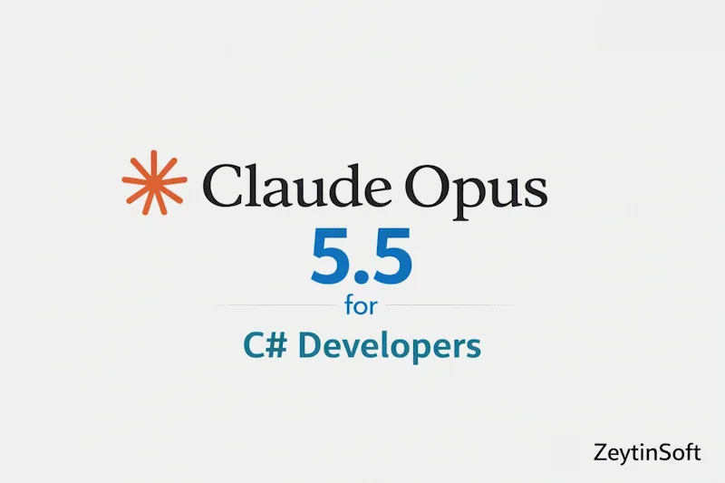

# Claude Opus 5.5 for C# Developers .NET 10



> Five runnable .NET 10 samples that call **Claude Opus 5.5** through **Microsoft Foundry**: code review, effort control, refusal handling, vision, and a bounded tool-calling agent loop.

[](https://github.com/taswar/ClaudeOpus5.5-Csharp-Demo/actions/workflows/dotnet.yml)


[](CONTRIBUTING.md)
[](https://github.com/taswar/ClaudeOpus5.5-Csharp-Demo/stargazers)

- 📖 Full walkthrough: [Claude Opus 5.5 for C# Developers](https://taswar.zeytinsoft.com/claude-opus-5-5-for-c-developers/)
- ⭐ If this saved you time, star the repo so other .NET developers can find it.
- 🔁 Related: [Claude Haiku 5.5 C# Demo](https://github.com/taswar/Claude-Haiku-5.5-CSharp-Demo), the fast, low-cost Claude model that pairs with Opus as a subagent
- For more C# samples using other AI models, see [AI models for C# developers](https://taswar.zeytinsoft.com/foundry-ai-models-csharp/)
- For my free ebook on prompt engineering, see [Prompt Engineering for .NET Developers](https://github.com/taswar/PromptEngineeringForDotNetDevelopers)

No framework to learn and no wrapper library: one small console app that shows what the Anthropic SDK for .NET can do, so you can copy the parts you need.

## Try it in 60 seconds (no API key)

```bash
git clone https://github.com/taswar/ClaudeOpus5.5-Csharp-Demo.git
cd ClaudeOpus5.5-Csharp-Demo
dotnet run -- 3
```

Expected output:

```
Request declined. Review the request or seek human review.
Offline refusal-handler check passed.
```

Case 3 runs entirely offline, so you can confirm your .NET 10 SDK setup before touching Azure.

## What's inside

| # | Sample | What it shows | Needs Foundry? |
|---|--------|---------------|----------------|
| 1 | **Code review** | Sends a C# counter class to Claude for a thread-safety review | Yes |
| 2 | **Low-effort response** | Uses `Effort.Low` for a fast, cheap summary of failing test names | Yes |
| 3 | **Refusal handling** | Parses a refusal response and handles it gracefully | No (offline) |
| 4 | **Vision** | Sends a screenshot of an exception dialog and asks for the likely cause | Yes |
| 5 | **Tool-calling agent** | A bounded loop (max 8 turns, `Effort.High`) that reads files via a tool and proposes a .NET Framework 4.8 → .NET 10 migration plan | Yes |

## Run against Claude

**1. Get access.** You need an Azure subscription and a Microsoft Foundry resource with a deployed Claude model. Note that this is a Foundry resource key, not a key from the public Anthropic Console.

**2. Store your credentials** (user secrets are kept outside the repo):

```bash
dotnet user-secrets set "AZURE_AI_FOUNDRY_RESOURCE" "my-foundry-resource"
dotnet user-secrets set "AZURE_AI_FOUNDRY_API_KEY" "<your-key>"
dotnet user-secrets set "AZURE_AI_FOUNDRY_DEPLOYMENT" "<your-deployment-name>"   # optional, defaults to claude-opus-5-5
```

**3. Run a sample:**

```bash
dotnet run -- 1          # code review
dotnet run -- 5          # tool-calling agent
dotnet run -- 4 ./error-dialog.png   # vision
dotnet run -- all        # everything
```

**Resource name:** use the first part of your Foundry endpoint. For `https://my-resource.services.ai.azure.com/anthropic`, set `my-resource`. The full URL also works.

**Using WSL?** User secrets are stored separately for Windows and WSL, so run the `dotnet user-secrets set` commands in the same environment where you run the app.

## Why this repo

- **Real SDK usage.** It uses the official `Anthropic` and `Anthropic.Foundry` packages, with no hidden helper layers.
- **A safe agent loop.** Sample 5 shows tool calling with a hard turn limit, a token cap per call and a shared ten-minute timeout.
- **Testable without a model.** The refusal handler is verified offline against a fixture.
- **Sensible secrets handling.** Keys come from user secrets or environment variables, and are redacted from error output.

## Good to know

- **Live calls cost money.** Sample 5 and `all` make several requests. Check your Foundry quota and pricing first.
- **Sample 5 is a simulation.** It only reads two code snippets embedded in `Program.cs`. It does not touch your files, run commands or migrate anything.
- **Sample 4 sends your image to the service.** Remove sensitive information first. PNG only, 4 MiB max.
- **Output varies.** Responses are model-generated and will differ between runs.

## Dependencies

| Package | Version | Purpose |
|---------|---------|---------|
| `Anthropic` | 12.50.0 | Messages API, images, effort settings, tool definitions |
| `Anthropic.Foundry` | 0.7.1 | Foundry client and API-key authentication |
| `Microsoft.Extensions.Configuration.EnvironmentVariables` | 10.0.0 | Environment-variable configuration |
| `Microsoft.Extensions.Configuration.UserSecrets` | 10.0.0 | Local development secrets |

Requires the **.NET 10 SDK** (not just the runtime).

## Project layout

```
ClaudeOpus55FoundryDemo.csproj         Target framework and NuGet references
Program.cs                             Configuration, the five samples, error handling
error-dialog.png                       Sample screenshot for the vision sample (4)
ClaudeOpus5.5forCSharpDevelopers.webp  Banner image for this README
.github/workflows/dotnet.yml           Build workflow that runs on every push and pull request
CONTRIBUTING.md                        How to report bugs and contribute changes
LICENSE                                MIT license
```

## Roadmap

- [ ] Run with a plain Anthropic API key (no Azure required)
- [ ] Split samples into separate files under `samples/`
- [ ] Streaming responses
- [ ] Structured JSON output deserialized into C# records
- [ ] Prompt caching example
- [ ] `Microsoft.Extensions.AI` `IChatClient` example

Have an idea? [Open an issue](https://github.com/taswar/ClaudeOpus5.5-Csharp-Demo/issues).

## Learn more

- [Claude Opus 5.5 for C# Developers (blog post)](https://taswar.zeytinsoft.com/claude-opus-5-5-for-c-developers/)
- [Use Anthropic Claude models in Microsoft Foundry](https://learn.microsoft.com/azure/foundry/foundry-models/how-to/use-foundry-models-claude)
- [.NET Secret Manager](https://learn.microsoft.com/aspnet/core/security/app-secrets)

## License

MIT. See [LICENSE](LICENSE).

If this saved you time, a ⭐ helps other .NET developers find it.
